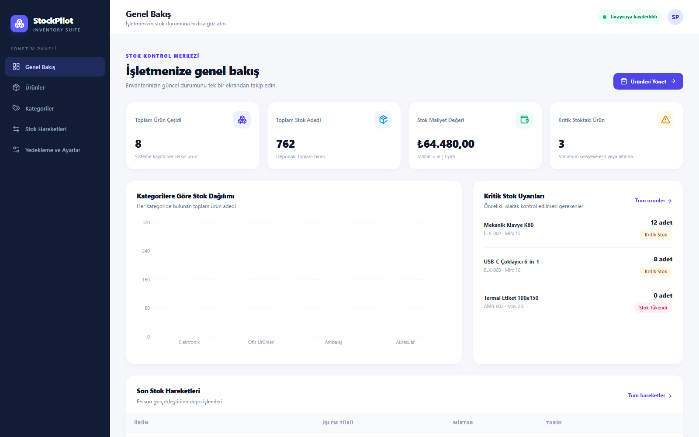
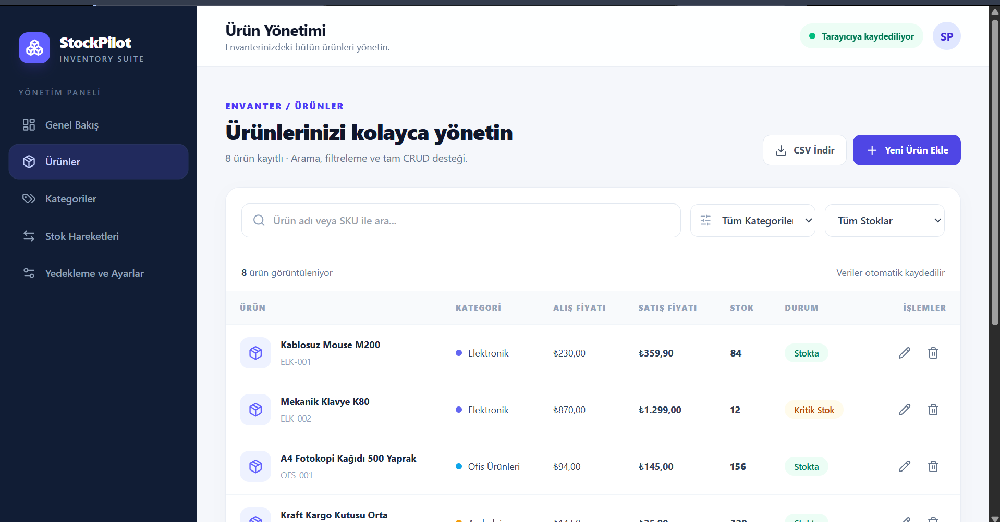
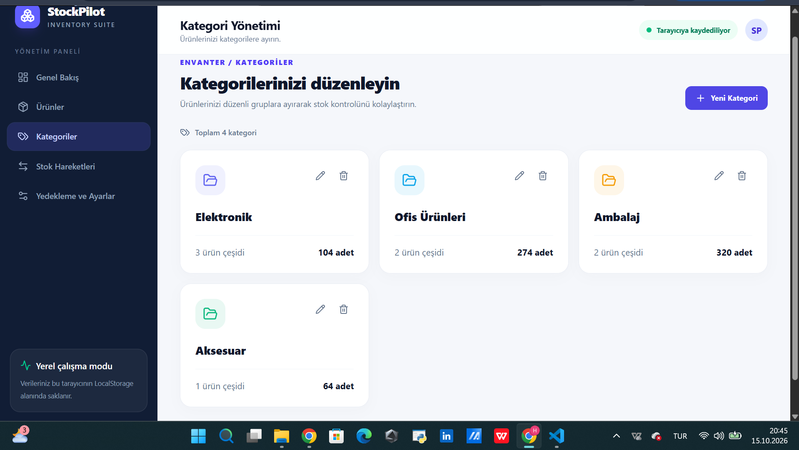
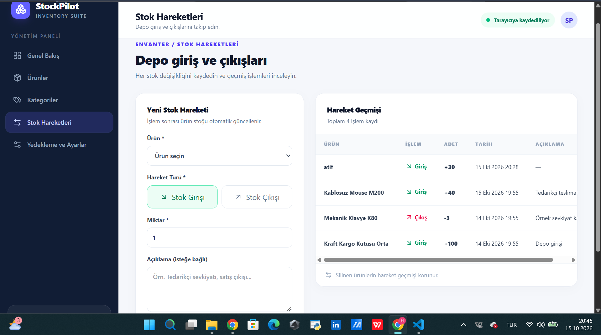
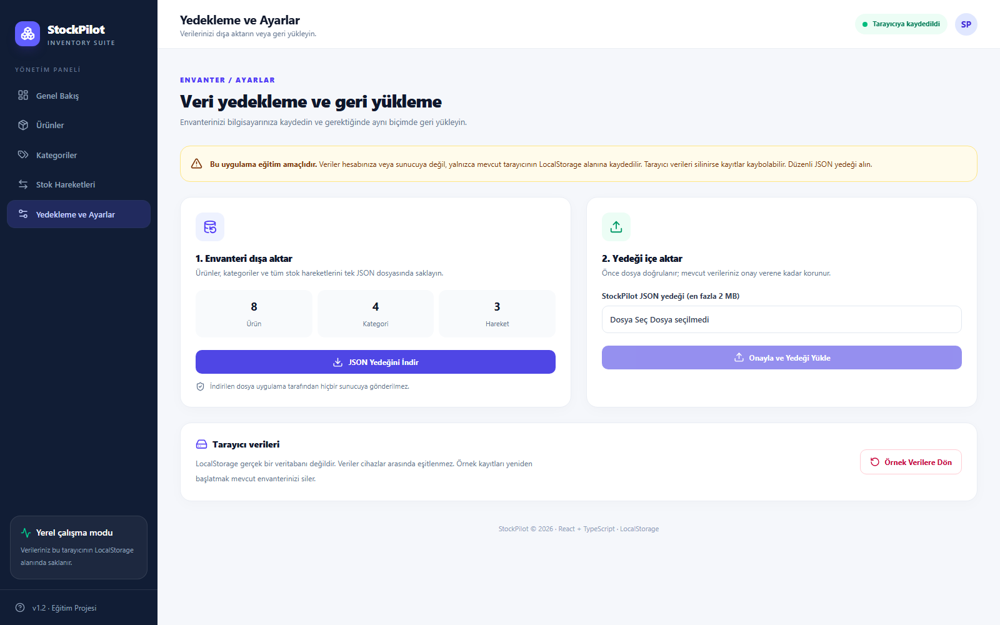

<p align="center">
  
</p>

<h1 align="center">StockPilot</h1>
<p align="center"><strong>Modern Stok ve Envanter Yönetim Sistemi</strong></p>
<p align="center">React · TypeScript · Tailwind CSS ile geliştirilen, tarayıcı tabanlı stok yönetimi uygulaması.</p>

<p align="center">
  
  
  
  
  
</p>

> [!IMPORTANT]
> **Eğitim ve portföy projesidir.** Veriler yalnızca kullanılan tarayıcının **LocalStorage** alanında saklanır. Merkezi veritabanı, kullanıcı hesabı, çok kullanıcılı senkronizasyon ve sunucu tarafı yetkilendirme bulunmaz. Bu sürüm gerçek işletme stokları için kullanılmamalıdır.

## İçindekiler

- [Genel bakış](#genel-bakış)
- [Özellikler](#özellikler)
- [Ekran görüntüleri](#ekran-görüntüleri)
- [Teknolojiler](#teknolojiler)
- [Kurulum ve çalıştırma](#kurulum-ve-çalıştırma)
- [Test ve kalite kontrolleri](#test-ve-kalite-kontrolleri)
- [Mimari ve klasör yapısı](#mimari-ve-klasör-yapısı)
- [Veri saklama ve yedekleme](#veri-saklama-ve-yedekleme)
- [Netlify ile yayınlama](#netlify-ile-yayınlama)
- [Bilinen sınırlamalar](#bilinen-sınırlamalar)
- [Sürüm geçmişi](#sürüm-geçmişi)

## Genel bakış

**StockPilot**, ürünlerin ve kategorilerin tek panelden yönetildiği, stok giriş-çıkışlarının kaydedildiği ve kritik stokların izlenebildiği modern bir envanter uygulamasıdır. Dashboard sayesinde stok miktarı, toplam maliyet değeri, kategori dağılımı ve son hareketler tek ekranda görülebilir.

**v1.2 ile gelen başlıca iyileştirmeler:** Test edilebilir iş kuralları, ürün sıralaması ve sayfalama, mobil uyumlu stok hareketi kartları, sayfa/grafik bazlı lazy loading ve LocalStorage kayıt hatası uyarıları.

## Özellikler

| Modül | Yetenekler |
| --- | --- |
| **Genel Bakış** | Ürün çeşidi, toplam stok, maliyet değeri, kritik stoklar, kategori grafiği ve son hareketler |
| **Ürün Yönetimi** | Ekleme, listeleme, güncelleme, silme; SKU doğrulama; arama, kategori/stok filtreleri; fiyat/stok/isim sıralama; 10/20/50 kayıtla sayfalama; CSV dışa aktarma |
| **Kategori Yönetimi** | Kategori ekleme, düzenleme, silme, renk seçimi ve bağlı ürün bulunan kategoriyi silmeye karşı koruma |
| **Stok Hareketleri** | Giriş ve çıkış işlemleri, otomatik miktar güncelleme, yetersiz stok kontrolü, geçmiş kayıtları ve sayfalama |
| **Yedekleme ve Ayarlar** | JSON dışa aktarma, dosya doğrulama, onaylı geri yükleme ve örnek verilere dönüş |

**Veri bütünlüğü:** Yinelenen SKU, geçersiz fiyat/miktar, bağlı kategorinin silinmesi ve stoktan fazla çıkış gibi işlemler engellenir. Silinen ürünlerin geçmiş hareket kayıtları korunur.

## Ekran görüntüleri

> **Görseller v1.2 uygulamasından alınmalıdır.** Bu README'nin görsel bağlantıları `docs/screenshots/` dizinine bakar. Önce [v1.2 görsel alma rehberini](docs/screenshots/README.md) uygulayıp beş PNG dosyasını güncelleyin.

### Genel Bakış



<details>
<summary><strong>Diğer ekranları göster: Ürünler, Kategoriler, Stok Hareketleri, Ayarlar</strong></summary>

### Ürün Yönetimi



### Kategori Yönetimi



### Stok Hareketleri



### Yedekleme ve Ayarlar



</details>

## Teknolojiler

| Katman | Teknoloji |
| --- | --- |
| Arayüz | React 19, TypeScript |
| Geliştirme / Derleme | Vite 7 |
| Stil | Tailwind CSS 4 |
| Yönlendirme | React Router 7 |
| Grafikler | Recharts 2.x |
| İkonlar | Lucide React |
| Veri saklama | Web LocalStorage API |
| Test | Node.js yerleşik test çalıştırıcısı |
| CI | GitHub Actions (`typecheck`, `test`, `build`) |
| Statik dağıtım | Netlify (`netlify.toml`) |

## Kurulum ve çalıştırma

**Önerilen ortam:** Node.js 22.12+ veya 24+ ve npm. Projede `npm test` için Node'un TypeScript dosyalarını çalıştırabilen sürümü gereklidir.

```bash
# Bağımlılıkları yükle
npm install

# Yerel geliştirme sunucusunu başlat
npm run dev
```

Terminalde görünen adresi açın. Genellikle `http://localhost:5173/` kullanılır. Port doluysa Vite farklı bir port (ör. `5174`) seçebilir.

**Diğer komutlar:**

```bash
npm run typecheck   # TypeScript tip denetimi
npm test            # Otomatik testler
npm run build       # dist/ üretim çıktısı
npm run preview     # Üretim çıktısını yerelde önizle
```

> **Not:** `npm run preview` kullanmadan önce `npm run build` çalıştırılmalıdır.

## Test ve kalite kontrolleri

**v1.2 yerel doğrulama sonuçları (15 Ekim 2026):**

| Kontrol | Sonuç |
| --- | --- |
| `npm run typecheck` | Başarılı |
| `npm test` | **23 test geçti, 0 başarısız** |
| `npm run build` | Başarılı — Vite 7.3.7, 2,93 sn |
| `npm install` | npm denetiminde 0 güvenlik açığı bildirildi |

Test senaryoları JSON yedeği doğrulama, ürün ve kategori CRUD kuralları, stok giriş/çıkışı, arama, filtreleme, sıralama ve sayfalamayı kapsar. Tam tarayıcı/uçtan uca test paketi henüz yoktur. Arayüz kontrolleri için [`docs/MANUEL_TESTLER.md`](docs/MANUEL_TESTLER.md) kullanılabilir.

> **Paket uyarısı:** `recharts@2.15.4` artık aktif bakım alan bir dalda değildir. Proje çalışırken bu uyarı derlemeyi engellemez; majör sürüm yükseltmesi ayrı test edilmelidir.

## Mimari ve klasör yapısı

```text
stockpilot/
├── .github/workflows/ci.yml       # GitHub Actions
├── docs/
│   ├── screenshots/                # Güncel v1.2 ekran görüntüleri
│   ├── MANUEL_TESTLER.md
│   └── TESLIM_REHBERI.md
├── public/logo.svg
├── scripts/capture_screenshots.ps1 # V1.2 ekran görüntüsü oluşturma yardımcısı
├── src/
│   ├── components/                 # Ortak React bileşenleri
│   ├── context/                    # InventoryProvider ve durum yönetimi
│   ├── hooks/                      # useInventory
│   ├── interfaces/                 # Veri tipleri
│   ├── pages/                      # Dashboard, Ürünler, Kategoriler, Hareketler, Ayarlar
│   ├── utils/                      # CRUD iş kuralları, arama/sayfalama, yedek, demo verisi
│   ├── App.tsx                      # Route tanımları ve lazy loading
│   └── main.tsx                    # Giriş noktası
├── tests/                          # 23 otomatik test
├── netlify.toml
├── package.json
└── index.html
```

**Uygulama akışı:** Arayüz bileşenleri `useInventory` üzerinden `InventoryContext` durumunu kullanır. CRUD ve stok kontrolleri `src/utils/inventoryOperations.ts` içindeki bağımsız fonksiyonlarla gerçekleştirilir. Değişiklikler aynı tarayıcının LocalStorage alanına kaydedilir.

## Veri saklama ve yedekleme

- Veriler `stockpilot-inventory-v1` LocalStorage anahtarı altında tutulur.
- İlk açılışta örnek ürün ve kategoriler oluşturulur.
- **Yedekleme ve Ayarlar** sayfasından ürünler, kategoriler ve hareketler bir JSON dosyasına aktarılabilir.
- Geri yükleme öncesinde dosya ve veri bütünlüğü doğrulanır; kullanıcı onayıyla mevcut kayıtların **yerine** yedek yüklenir.
- Tarayıcı verilerini silmek, farklı port kullanmak veya farklı cihazda açmak önceki kayıtları otomatik olarak taşımaz. Gerektiğinde JSON yedeğini içe aktarın.

**Gizlilik:** GitHub'a gerçek müşteri verileri, özel stok verileri, JSON yedekleri, erişim anahtarları veya gizli dosyalar yüklemeyin.

## Netlify ile yayınlama

Uygulama Vite tarafından statik olarak derlenir; Netlify için `netlify.toml` hazırdır:

```toml
[build]
  command = "npm run build"
  publish = "dist"

[[redirects]]
  from = "/*"
  to = "/index.html"
  status = 200
```

1. Projeyi GitHub'da **public** bir depoya gönderin.
2. Netlify → **Add new project** → **Import an existing project** üzerinden GitHub deponuzu seçin.
3. **Build command:** `npm run build` — **Publish directory:** `dist` — **Branch:** `main`.
4. Dağıtımdan sonra `/products`, `/categories`, `/movements`, `/settings` yollarını ve CRUD işlemlerini kontrol edin.
5. Canlı bağlantıyı eğitim teslim formuna ekleyin.

**Canlı demo:** GitHub ve Netlify yayını tamamlandıktan sonra buraya doğrulanmış bağlantı eklenecek.

## Bilinen sınırlamalar

- Kullanıcı girişi, roller ve yetkilendirme yoktur.
- Merkezi veritabanı, API veya cihazlar arası senkronizasyon yoktur.
- LocalStorage kalıcı yedekleme sistemi değildir; tarayıcı verileri silinebilir.
- İş kuralları otomatik olarak test edilse de uçtan uca tarayıcı testleri henüz eklenmemiştir.
- Recharts 2.x güncelleme uyarısı bulunmaktadır.

## Sürüm geçmişi

| Sürüm | Değişiklikler |
| --- | --- |
| **v1.2.0** | İş kuralları modülerleştirildi; 23 teste ulaşıldı; ürün sıralama ve sayfalama, mobil hareket görünümü, lazy loading, kayıt hatası bildirimi eklendi. |
| **v1.1.0** | JSON yedekleme/geri yükleme, doğrulama, ayarlar sayfası, ilk otomatik testler ve teslim dokümantasyonu. |
| **v1.0.0** | Dashboard, ürün/kategori CRUD, stok hareketleri, kritik stok takibi, LocalStorage temel işlevleri. |

---

**StockPilot v1.2** · React + TypeScript · Eğitim ve portföy çalışması
